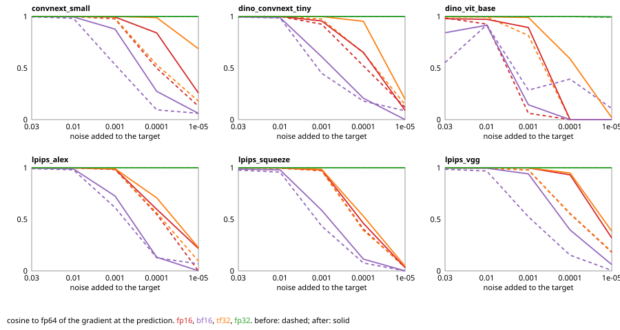

# SenseCraft

Perceptual and signal losses for image and video models, with our own feature nets, a compose layer
that returns the gradient at the prediction directly, and a measured precision and speed record for
every term.

Work in progress.

## Install

```bash
pip install sensecraft            # torch, safetensors, pytorch-msssim
pip install "sensecraft[dinov3]"  # adds huggingface_hub for the DINOv3 terms
```

Python 3.13. Pretrained weights are converted once to safetensors under `~/.cache/sensecraft`
(`SENSECRAFT_CACHE` moves it). VGG, AlexNet and SqueezeNet come from the torchvision URLs; the LPIPS
heads ship in the package. DINOv3 checkpoints are gated on Hugging Face, so their first use needs a
token.

## Use

```python
import torch
from sensecraft import Loss, Term

loss = Loss(
    [
        Term("mse"),
        Term("lpips", 0.5, net="vgg"),
        Term("dino_vit", 250, model="base", use_gram=False),
        Term("ssim", monitor=True),          # logged, not in the total
    ],
    dims=2,                                  # 3 for (B, T, C, H, W) video
    input_range=(-1, 1),
).prepare("cuda", torch.bfloat16, torch.channels_last, compile="term")

out = loss(fake, real)                       # out.total, out.terms
out = loss.value_and_seed(fake, real)        # also out.seed = d total / d fake, no graph kept
```

- Each term reads its images in the range it was trained for; `Loss` converts from `input_range`.
- Image terms run per frame on video; video terms see the clip.
- `prepare` puts the feature nets in the compute dtype and layout and compiles by scope: `off`,
  `term` or `loss`. Distances stay in fp32.
- Plain terms (pixel, edge, FFT, SSIM, video) run in strict fp32: autocast off, fp32 inputs, and
  IEEE fp32 convs and matmuls instead of TF32.
- Feature nets run their convs, matmuls and attention in the compute dtype. The layer that reads the
  image keeps the image's low bits, and the residual stream, norms, activations and layer scales
  run in fp32; see Precision.
- Nothing reads the host: totals and terms stay on the device.

Metrics on the same units, without gradient:

```python
from sensecraft.metrics import lpips, ms_ssim, psnr, ssim

psnr(fake, real, data_range=2.0)
```

## Terms

| Group | Names |
| --- | --- |
| Perceptual | `lpips` (vgg, alex, squeeze), `dino_vit`, `dino_convnext`, `convnext` |
| Pixel | `mse`, `l1`, `huber`, `smooth_l1`, `rmse`, `mape`, `smape`, `log_cosh`, `quantile`, `cauchy`, `geman_mcclure`, `welsch`, `tukey`, `wing`, `charbonnier`, `gaussian_noise` |
| Frequency | `fft`, `patch_fft` |
| Edge | `sobel`, `laplacian`, `canny`, `gradient`, `high_freq`, `multi_scale_gradient`, `structure_tensor` |
| Structure | `ssim`, `ms_ssim` |
| Video | `ssim3d`, `stssim`, `tssim`, `fdb`, `temporal_accel`, `temporal_fft`, `patch_fft_3d`, `temporal_gradient` |

A new term is an `nn.Module` with `forward(input, target) -> scalar`, registered with
`@register(name, Range.UNIT, dims="2d", fp32=False)`. `fp32=True` runs it in strict fp32.

## Layout

```text
src/sensecraft/
  nets/        feature nets, features only: VGG16, AlexNet, SqueezeNet, ConvNeXt, DINOv3 ViT and ConvNeXt
  weights/     upstream sources, conversion to cached safetensors, the LPIPS heads
  distance/    LPIPS and feature distances, in fp32
  perceptual/  terms: a net and a distance
  pixel/       pixel regression terms
  signal/      FFT, edge, SSIM and video terms
  kernels/     fused ops with plain PyTorch fallbacks, the split-input first layer
  compose.py   Term, Loss, value_and_seed
  precision.py strict fp32 for the plain terms
  prepare.py   dtype, layout and compile scope
  metrics.py   metrics on device tensors
measure/       the precision and speed chain, see measure/README.md
checks/        behavior checks run by hand, see checks/README.md
```

## Precision

Every perceptual term matches upstream at fp64 (S1, error at the level of fp64 rounding), and every
fixed term matches 0.3.13 exactly at fp64 (S5). Against fp64, at the same dtype as upstream:

| Term | dtype | Value gradient cosine, ours | upstream |
| --- | --- | --- | --- |
| LPIPS SqueezeNet | fp16 | 0.991 | 0.607 |
| LPIPS VGG | bf16 | 0.991 | 0.985 |
| LPIPS VGG | fp16 | 0.996 | 0.995 |
| DINOv3 ViT-B | bf16 | 0.953 | 0.925 |
| DINOv3 ViT-B | fp16 | 0.939 | 0.793 |

The LPIPS distance runs in fp32: in fp16 the channel sum of squares overflows, and in bf16 the
difference of two close unit vectors cancels. Value error drops 3 to 5x in bf16 and from 28% to
0.02% for SqueezeNet in fp16. Its unit vectors take the eps inside the root, so an all-zero feature
vector has a finite gradient. DINOv3 ConvNeXt rows are measured on random stand-in weights.

### Near-identical images

A perceptual term's gradient at the prediction comes from the difference between the features of
the prediction and of the target. When the two images differ by less than the spacing of the
compute dtype, that difference is rounded away and the gradient keeps little of its direction.
This is not fp16 only: bf16 keeps 8 mantissa bits, fp16 and TF32 keep 10.

S7 (`measure/s7_near.py`) runs each term on 8 ImageNet validation images against the same images
plus Gaussian noise, and compares the gradient with an fp64 run. Rounding one point at a time to
fp16 in an otherwise fp64 net showed where the bits go: casting the image to the compute dtype
before the first layer loses almost all of it, and in DINOv3 ViT the residual stream loses most of
the rest. Rounding the backward pass at a training loss scale costs nothing.

So the layer that reads the image runs on the image split in two, the image rounded to the compute
dtype and the scaled remainder, and adds the two outputs in fp32. In DINOv3 ViT and the ConvNeXts
the residual stream, norms, rope, activations and layer scales run in fp32. Convs, matmuls and
attention stay in the compute dtype. Cosine to fp64, before and after:

| Term | dtype | noise 1e-2 | noise 1e-3 | noise 1e-4 |
| --- | --- | --- | --- | --- |
| LPIPS VGG | fp16 | 0.997 to 0.999 | 0.978 to 0.998 | 0.554 to 0.931 |
| LPIPS VGG | bf16 | 0.968 to 0.995 | 0.525 to 0.941 | 0.153 to 0.396 |
| LPIPS VGG | TF32 | 0.997 to 0.999 | 0.978 to 0.999 | 0.558 to 0.949 |
| DINOv3 ViT-B | fp16 | 0.927 to 0.973 | 0.062 to 0.894 | -0.129 to -0.116 |
| DINOv3 ViT-B | bf16 | 0.918 to 0.915 | 0.286 to 0.144 | 0.393 to -0.604 |
| DINOv3 ViT-B | TF32 | 0.996 to 0.997 | 0.816 to 0.991 | -0.176 to 0.590 |
| ConvNeXt small | fp16 | 1.000 to 1.000 | 0.976 to 0.995 | 0.499 to 0.841 |
| ConvNeXt small | bf16 | 0.983 to 0.996 | 0.533 to 0.877 | 0.095 to 0.274 |

Strict fp32 stays above 0.99 at every noise. Noise 1e-3 on [-1, 1] images is about 66 dB PSNR, so
this matters where a reconstruction is already near exact, and for DINOv3 ViT in bf16 or fp16 well
before that. DINOv3 ViT-B at larger differences, mean of 4 batches of 8, before and after:

| dtype | noise 0.03 | noise 0.1 | noise 0.3 | another image |
| --- | --- | --- | --- | --- |
| fp16 | 0.970 to 0.979 | 0.915 to 0.936 | 0.764 to 0.888 | 0.929 to 0.991 |
| bf16 | 0.936 to 0.935 | 0.889 to 0.883 | 0.606 to 0.775 | 0.926 to 0.964 |

Every term and mode is in `measure/figures/s7_near.svg`; dashed lines are before.



Changed on purpose against 0.3.13: `tssim` reads [-1, 1] clips, which its formulas assume; `ssim3d`
and `stssim` read [0, 1] clips instead of guessing the range from the input's minimum.

## Speed

Batch 32, 256 px, one RTX 5090, bf16, channels-last, compiled per term, forward and the gradient at
the prediction; the 0.4.0 and current columns are measured in the same session:

| Term | 0.3.13 | 0.4.0 | now |
| --- | --- | --- | --- |
| LPIPS VGG | 29.5 ms | 23.6 ms | 25.8 ms |
| DINOv3 ViT-B | 21.5 ms | 20.1 ms | 20.9 ms |
| ConvNeXt small | | 8.8 ms | 9.2 ms |
| DINOv3 ConvNeXt tiny | | 8.3 ms | 8.6 ms |

The split first layer and the fp32 stream cost 2.2 ms on LPIPS VGG, whose first layer works at full
resolution, and under 1 ms on the others.

LPIPS runs every conv, bias and ReLU as one cuDNN op with an input-only backward, since feature net
weights never take gradients; its heads are a channel sum inside the fused distance, and VGG's pools
keep no indices (peak memory 2.8 to 1.8 GB). LPIPS runs channels-last inside whatever layout it
is given; from NCHW input that is 36 ms otherwise. DINOv3 embeds patches with one matmul. The full
numbers, per-layer floor ratios and the changes that were tried and dropped are in `measure/`.

## License

Apache-2.0. The LPIPS heads and the pretrained nets keep their own licenses; see `LICENSE-NOTICES`.
